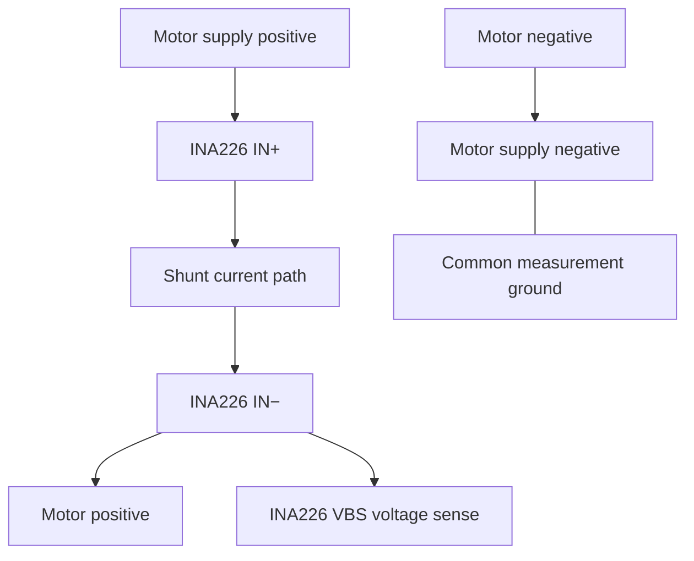

# DIY Motor Dynamometer Using Raspberry Pi

# Setup and everyday operation

## Assemble in stages

Start with the mechanical arrangement: align the motor and generator, secure the coupler, arrange the reaction arm so the intended torque reaches the load cell, and prevent the supports or cables from bypassing that force path. The final mounting drawing is still needed.

With power disconnected, wire the sensors and relay network from the wiring record. Check connections against the exact module markings. Test the sensor readings individually before enabling automated switching. With the generator disconnected, measure the relay-selected resistances. Establish a stable Pi supply before collecting data.

Calibrate voltage/current against a trusted meter. Calibrate force using a known mass and a measured perpendicular lever arm. The constants shipped in this code belong to the recorded rig; another builder must establish their own. At 10 g and 74 mm, the reference torque is `0.010 × 9.80665 × 0.074 = 0.007256921 N·m`.

## Install the software

Copy the included `motor_lab` directory to `~/dyno/motor_lab` on the Pi. Stop any other program using these GPIO pins first. Enable the Pi's I2C interface and ensure the normal user has access to I2C/GPIO. The installer does not configure those interfaces.

With motor and relay supplies OFF, run as the normal Pi user:

```bash
bash ~/dyno/motor_lab/install.sh
```

The installer uses systemd and installs missing gpiozero/lgpio/smbus packages through apt. Open `http://raspberrypi.local:8766` on a device on the same trusted local network. If the name does not resolve, use the Pi's LAN address. Do not expose this control server to the internet.

The service starts at boot. It does **not** start motor power or a sweep automatically. Results are stored under `~/dyno/auto_runs/`.

## Run a test

1. Turn motor power OFF and let the shaft stop. For the recorded hardware, start with 6 V and maximum load 5.
2. Choose direction as viewed from the same shaft end. Confirm motor OFF and click **New test**.
3. Click **Capture slow-turn baseline**. Slowly turn the shaft in that direction for 45 seconds, covering several revolutions. Do not press on the reaction arm.
4. Release the shaft and wait through the 10-second settling period.
5. Set the motor supply voltage and a 2 A current limit, keeping its output OFF. Turn on the relay coil supply, clear the moving parts, then use **Arm sweep** and manually switch motor output ON when instructed.
6. Keep the controlling browser tab visible and remain beside the physical power switch. The sweep increases and decreases load automatically.
7. At **FINISHED** or **ABORTED**, manually switch motor power OFF. Open **View results** to review or download the recording.

Loads 1–5 hold for 5 seconds, 6 for 3 seconds, and 7 for 2 seconds. These are short measurements, not continuous thermal ratings. The recorded maximum current was almost the 1.9 A cutoff; extending the load range is a separate upgrade.

## Software checks without hardware

```bash
cd ~/dyno/motor_lab
python3 -m unittest -v test_app.py
python3 app.py --demo --host 127.0.0.1 --port 8877
```

Demo data are simulated. Software tests do not validate wiring, contact ratings, or load-cell mechanics. See `motor_lab/README.txt` for service commands and full runtime limits.


---

# Electrical wiring record

This is a reconstruction from the recorded build and software, not a photograph-verified final schematic. Verify every connection against the physical rig with all supplies disconnected. **GPIO numbers below are BCM numbers; physical numbers refer to the Raspberry Pi 40-pin header.**

## Raspberry Pi sensor connections

| Function | Module terminal | BCM / bus | Physical pin |
|---|---|---|---:|
| HX711 power | VCC | 3.3 V | 1 or 17; actual branch to confirm |
| HX711 ground | GND | Ground | 30 |
| HX711 data | DT / DOUT | GPIO5 | 29 |
| HX711 clock | SCK | GPIO6 | 31 |
| RPM sensor power | VCC | 3.3 V | 17 |
| RPM sensor ground | GND | Ground | 34 |
| RPM signal | OUT | GPIO13 | 33 |
| INA226 power | VCC | 3.3 V | 1 or 17; actual branch to confirm |
| INA226 ground | GND | Ground | 9 |
| INA226 data | SDA | GPIO2 / SDA1 | 3 |
| INA226 clock | SCL | GPIO3 / SCL1 | 5 |

INA226 address: `0x44`. Alert output unused. RPM configuration: **2 pulses per revolution**; a replica must verify its own sensor and target count. Confirm the sensor output is compatible with 3.3 V GPIO.

## Load cell to HX711

| Load-cell wire in this build | HX711 terminal |
|---|---|
| Red | E+ |
| Black | E− |
| Green | A+ |
| White | A− |

This was a provisional identification for an unlabelled four-wire cell. Wire colors are not universal. Confirm excitation and signal pairs for any replacement cell. The load-cell model, capacity, and mechanical mounting remain to be documented.

## Motor supply and INA226



Confirm the physical supply-negative/common-ground connection in the final photos. INA226 module ground must share the measurement reference. Motor current flows through suitable power wires and the module's power terminals, **not through Pi header or Dupont signal leads**.

Recorded current path: original **R100 (0.1 Ω)** with an added bank of **20 × 1 Ω in parallel across it**. The software's empirical divisor is **0.02663 V/A**, checked against a meter up to 2 A. This is an empirical calibration, not a precision specification of the physical resistor network. Voltage uses factor **0.95115**.

A proposed replacement with one R010 is future work: remove the original shunt and added parallel bank, fit the suitable replacement, then recalibrate and verify the board's current path. Do not use the old current divisor after changing the shunt.

## Relay control and power

The build photos show two four-channel relay boards (eight relays total). The recorded control uses active-low inputs. The verified software mapping deliberately differs from an earlier incorrect grouping.

| Relay | BCM GPIO | Physical pin | Role |
|---|---:|---:|---|
| K1 | 24 | 18 | Resistor routing |
| K2 | 25 | 22 | Resistor routing |
| K3 | 12 | 32 | Resistor routing |
| K4 | 16 | 36 | Resistor routing |
| K5 | 17 | 11 | Resistor routing |
| K6 | 27 | 13 | Resistor routing |
| K7 | 22 | 15 | Resistor routing |
| K8 | 23 | 16 | Generator load master disconnect |

Recorded relay module arrangement: **12 V coil supply to JD-VCC**, power jumper(s) removed, Pi **3.3 V to logic VCC**, common ground. Confirm the exact board's terminal labels and jumper arrangement before copying: this is not a universal relay-board wiring rule. Never connect the 12 V coil supply to a Pi GPIO or 3.3 V rail. Exact relay module model, input circuitry, and DC contact ratings are pending.

K8 must remain off during boot and loss of control. Hardware pull-up/bias implementation has not been verified in the build record. Software initialization alone is not an independent shutdown system.

## Complete generator load netlist

Three nominal **5.6 Ω, 25 W** resistors are designated R1, R2, R3. A and B identify each end, not polarity. Each row is one electrically connected node. COM, NC, and NO refer to the printed contact labels, not their physical left/right position.

| Node | Connect all listed terminals together |
|---|---|
| N1 | Generator +, K8 COM |
| N2 | Generator −, K1 NO, K4 NO, K5 NC |
| N3 | R1 A, K8 NO, K3 NO, K7 NO |
| N4 | R1 B, K1 COM |
| N5 | R2 A, K3 COM |
| N6 | R2 B, K2 COM |
| N7 | R3 A, K6 COM |
| N8 | R3 B, K5 COM |
| N9 | K1 NC, K3 NC, K7 NC |
| N10 | K4 NC, K6 NC |
| N11 | K2 NC, K4 COM |
| N12 | K6 NO, K7 COM |

K2 NO, K5 NO, and K8 NC are unused and insulated. Keep the generator load circuit separate from the motor supply circuit; confirm generator case isolation and final grounding in the mechanical/electrical review.

## Relay states and nominal loads

`1` means coil energized, so its GPIO output is LOW. `0` means coil off, with COM connected to NC. K8 closes only after routing is set.

| Load | Nominal Ω | K1 | K2 | K3 | K4 | K5 | K6 | K7 | K8 |
|---|---:|---:|---:|---:|---:|---:|---:|---:|---|
| 0 | Open | — | — | — | — | — | — | — | Off |
| 1 | 16.8 | 0 | 0 | 0 | 0 | 0 | 0 | 0 | On |
| 2 | 11.2 | 0 | 0 | 0 | 1 | 1 | 0 | 0 | On |
| 3 | 8.4 | 0 | 0 | 0 | 1 | 0 | 1 | 0 | On |
| 4 | 5.6 | 1 | 1 | 0 | 0 | 1 | 0 | 0 | On |
| 5 | 3.733 | 1 | 0 | 1 | 0 | 0 | 0 | 0 | On |
| 6 | 2.8 | 1 | 0 | 1 | 1 | 1 | 0 | 0 | On |
| 7 | 1.867 | 1 | 0 | 1 | 1 | 0 | 1 | 1 | On |

Measured resistor values were approximately 5.76, 5.85, and 5.95 Ω. Setting 6 was measured near 3.01 Ω after probe-resistance correction, rather than the nominal 2.8 Ω. Before connecting the generator, verify every selected resistance with a meter using the relay board alone. Do not measure resistance on an energized circuit.

Switching order: open K8, wait 0.2 s, change routing, wait 0.2 s, close K8. These are commanded states; the software has no contact-position feedback.

The 25 W labels require suitable cooling and mounting. Total bank resistance does not prove that each resistor is below its power limit. Final heatsink dimensions and mounting photographs are pending.


---

# Measurements, calibration, and evidence

## Included evidence

`data/original` contains the unchanged samples, averaged points, baseline, and metadata from run `20261117_183439_340263`. It is real recorded hardware data, not demo output. The original metadata intentionally retains the old torque-calibration description so the correction remains traceable.

`data/derived/results_corrected.csv` applies the documented ×10 correction to torque. Reproduce it with `python3 tools/derive_results.py` from the repository root. The script rejects metadata that does not match this particular historical coefficient.

## Calculation

- Electrical input power: measured voltage × measured current.
- Reference calibration torque: mass × gravitational acceleration × perpendicular arm length.
- Provisional torque: change in load-cell counts × calibrated torque per count, relative to the captured baseline.
- Apparent mechanical power: torque in N·m × RPM × 2π / 60.
- Apparent efficiency: apparent mechanical power / electrical input power × 100.

The recorded original coefficient was based on 7.4 mm. Correcting to the builder's reported 74 mm changes torque, apparent mechanical power, and apparent efficiency by ×10; RPM, voltage, current, and electrical input are unchanged. The corrected coefficient is `-0.007256921 / 170499 N·m per count`.

At the ascending setting-7 average, this gives approximately 16.15 mN·m, 6.48 W apparent output, and 58.6% apparent efficiency. The number is plausible but not sufficient evidence of true motor efficiency.

## What this run establishes

All 15 commanded holds were recorded, including the ascending and descending loads. Speed fell and electrical demand rose with increasing load. Matching up/down load averages for settings 1–6 were within approximately 1.62% in RPM and 1.99% in current. This is within-run consistency, not independent accuracy or repeatability across multiple experiments.

## Limits that matter

- The reaction arm's mechanical torque path has not been independently verified. Housing friction, bearings, cable restraint, and support geometry can bias force.
- The baseline uses the centre of same-direction detected peaks and valleys. It does not prove that cogging is symmetric or remove all friction.
- Reference mass, perpendicular distance, and force calibration need independent confirmation over several known loads.
- Sensor windows are asynchronous: RPM about 1 s, HX711 about 0.3 s averaging, and INA226 about 0.53 s averaging. Ten logged rows per second are not ten independent conversions.
- Transitions are excluded for 0.8 s in point averaging. Short high-load holds still do not establish settled or thermally sustainable behavior.
- Voltage/current corrections were checked against a meter only over the original operating range. No upgraded-current-path calibration is demonstrated here.
- The run contains no temperature measurements. The measured current peaked near 1.897 A, just below the 1.9 A software cutoff.

For a stronger efficiency claim, verify the force path and multi-point torque calibration, check RPM against an independent tachometer, repeat matched sweeps, and quantify measurement uncertainty. Keep the original observations even when a calibration is corrected.


## Project files
The source code, original test data, photos, and STEP files are not yet uploaded to this repository.
